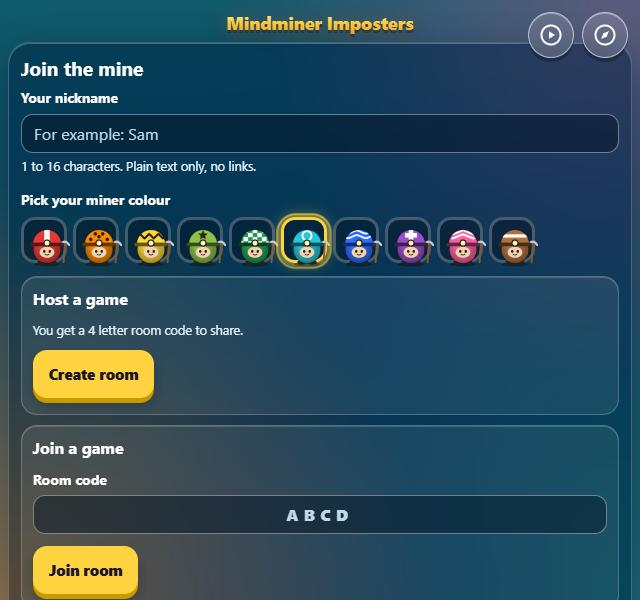

# Mindminer Imposters

**Play it: https://markbasa96.github.io/mindminer-imposters/**

A party game for your team that runs in the browser. Miners work together to finish tasks down in the mine, while a few hidden fakers try to stop them. Nothing to install: one person hosts, everyone else joins with a 4-letter room code.

| The intro | The lobby |
|---|---|
|  |  |

## How to play

1. **Join the mine.** Type a nickname and pick one of ten miner colours.
2. **Host or join.** The host creates a room and shares the 4-letter code. Up to 10 players can join, and the lobby has a chat.
3. **Pick a round.** The host chooses the round and its timings, and can set an optional campfire question to warm everyone up first.
   - **Warm-up:** collect gems and finish the 3 team tasks before time runs out.
   - **Imposters** (4 to 10 players): a few players are secretly fakers.
4. **Miners** follow the arrow to each task and fill the team bar before time runs out.
5. **Fakers** blend in, pretend to do tasks, tag miners out and dim the lamps. They win if they match the number of miners left.
6. **Meetings.** Ring the meeting bell or report a body, talk it over in the meeting chat, then vote. Whoever gets the most votes is out.

A short animated intro and a 5-step guided tour play on the first visit. You can replay both from the start screen.

## Controls

| Key | What it does |
|---|---|
| W A S D or arrows | Move |
| E or Space | Use: collect a gem, start a task |
| Q | Tag a nearby miner (fakers) |
| R | Sabotage a nearby lamp (fakers) |
| F | Report a body |
| B | Ring the meeting bell |
| 1 to 9 | Vote for that player |
| T | Type in the chat |
| C | Copy the room code |
| S / P | Start or pause the game (host only) |
| M | Sound on or off |
| Esc | Open or close the menu, or cancel a task |
| ? | Show all shortcuts |

On phones and tablets every action has an on-screen button (Use, Tag, Sabotage, Report, Call meeting).

## How it is built

- One `index.html` file: plain HTML, CSS and JavaScript, no build step. The miners, gems, lamps and campfire are drawn in code on a canvas.
- Multiplayer is peer to peer with [PeerJS](https://peerjs.com) (WebRTC). The host's browser runs the game and the other players connect straight to it. There is no game server and no database.
- Hosted free on GitHub Pages.

To run it locally, serve the folder with any static server (for example `python -m http.server 8000`) and open it in two browser windows.

## Credits

Made by [Joemark Basa](https://markbasa96.github.io), built with [Claude Code](https://claude.com/claude-code).
