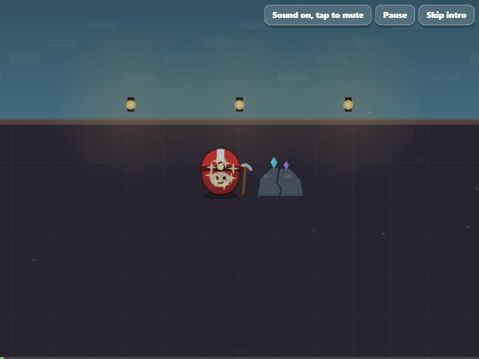

# MindMiners

**Play it: https://markbasa96.github.io/mindminers/**

A browser party game for team calls. Everyone is a little miner in a cave: warm up together, share at the campfire, then draw and guess words while walking into glowing crystals to reveal letters. Nothing to install: one person hosts, everyone else joins with a 4-letter room code, on a laptop or a phone.

| The intro | The lobby |
|---|---|
|  |  |

## How to play

1. **Join the mine.** Type a nickname and pick one of ten miner colours.
2. **Host or join.** The host creates a room and shares the 4-letter code. Up to 10 players can join, and anyone with the code can join at any time, even after a round has started.
3. **Peace Pipe (optional icebreaker).** The host sets a question. Everyone types a short answer, and the answers float around the campfire with no names. Then the host spins the wheel to pick who talks about their answer.
4. **Warm-up.** Everyone is on one team: collect gems and finish 3 team tasks to fill the shared bar before time runs out.
5. **Word Dig.** One miner picks a word and draws it. Everyone else watches the drawing, sees blanks for the letters, and types guesses.
   - Walk into a glowing letter crystal to reveal that letter for everyone. The game also reveals a letter by itself halfway through and near the end.
   - Faster correct guesses score more, and the drawer scores for every correct guesser.
   - Everyone draws once per round. The host picks 1 to 3 rounds, a word list (Food, Animals, Fruits, Everyday things, Nature) or their own secret custom words.
   - The game ends with a top 3 podium.
6. **Speaker wheel.** Between games, the host spins a wheel that everyone sees to pick who shares next (Updates, Sharing, Peace Pipe). Picked names drop off until the host resets the wheel.

Only the host sees the room settings, custom words and Peace Pipe question. Other players see the lobby chat and a short line saying what game is next.

A 30-second animated intro and a short guided tour play on the first visit. You can replay both from the icons at the top right of the start screen.

## Controls

| Key | What it does |
|---|---|
| W A S D or arrows | Move |
| E or Space | Use: collect a gem, start a task |
| T | Type in the chat, or jump to the guess box in Word Dig |
| Enter | Send your guess |
| 1 to 3 | Pick a word when it is your turn to draw |
| C | Copy the room code |
| S | Start the game (host only) |
| W | Open the speaker wheel (host only) |
| P | Pause or resume (host only) |
| M | Sound on or off |
| Esc | Open or close the menu, or cancel a task |
| ? | Show all shortcuts |

On phones and tablets there is an on-screen stick to move and a Use button, and the drawing board fills the screen when it is your turn to draw.

## How it is built

- One `index.html` file: plain HTML, CSS and JavaScript, no build step. The miners, gems, crystals, campfire and wheel are drawn in code on a canvas, and the music and sound effects are made in the browser.
- Multiplayer is peer to peer with [PeerJS](https://peerjs.com) (WebRTC). The host's browser runs the game and the other players connect straight to it. A free relay helps players on other networks connect. There is no game server and no database, and nothing is saved after the room closes.
- Hosted free on GitHub Pages.

To run it locally, serve the folder with any static server (for example `python -m http.server 8000`) and open it in two browser windows.

## Credits

Made by [Joemark Basa](https://markbasa96.github.io), built with [Claude Code](https://claude.com/claude-code).
